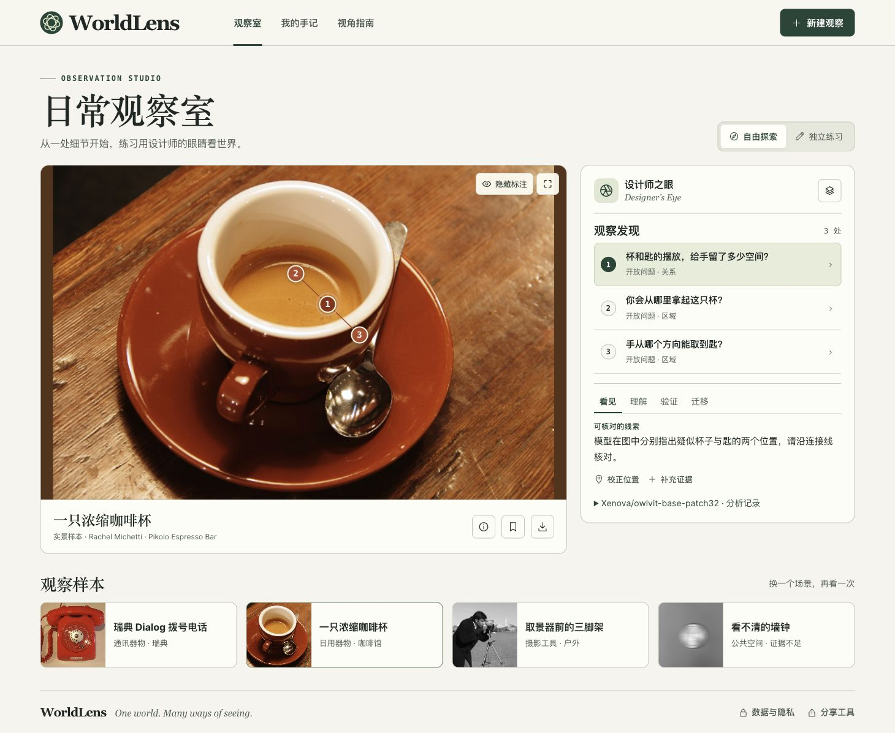

# WorldLens 验证记录

2026 年 11 月 24 日，macOS arm64，Node.js 22.14.0。以下记录区分程序测试、真实推理、编辑示例和待测的人类学习效果。

## 0.2 版的阅读走查

在公开网页的 Chrome 上实际点选与切换，桌面视口为 1460 × 742，窄屏视口为 390 × 844。后者为浏览器的响应式检查，真实手机拍摄尚待实机验证。

| 检查 | 实际结果 |
| --- | --- |
| 在红色电话上依次打开「看线索」「想原因」「动手试」「换场景」 | 问题从金属挡片的位置出发。原因页讲触感如何提供终点，检验页要求从两个孔试拨，并写明哪些结果会改变判断，迁移页换到旋钮。一次只展示当前阶段。 |
| 放大挡片，再换到数字与指孔 | 放大镜使用与主图相同的 2416 像素宽源图。弹窗中的局部宽 582 像素。点下一个发现后编号变为 02，证据随之切换。隐藏标注后原图上的三个按钮消失，再打开即可恢复。 |
| 在 390 像素宽度点图，再独立练习 | 页面没有横向溢出，主图宽 358 像素，解释正文为 17 像素。点选后，图和当前证据可同时看见。进入独立练习后，先出现自己的观察输入框，导览问题与提示均隐藏。 |
| 从咖啡样本运行 OWL-ViT | 返回三个观察。其中一条指出模型在画面上方标出疑似杯子、在中央标出疑似匙，提出走哪个方向可能碰到杯的问题。检验页指出，如果两个方向同样方便，就应放弃仅凭距离判断挡手的解释。 |
| 从模糊墙钟运行 Tesseract LSTM | 返回零条可读的操作提示。页面请使用者补拍文字与对应部件的近照，并提供补充证据入口。 |

这次走查促成了两处修正。手机上问题会从「哪儿」中间断行，改为优先按整句或短语换行，并把指示观察位置的一句话单独排出。重新访问时，浏览器曾将新首页与旧的解释脚本组合，现已给同一次发布的样式、脚本与框架数据使用一致的版本参数。

项目共 17 项自动化测试。其中新增的三个检查覆盖分层阅读与旧手记、局部放大框和证据的对应关系、不同位置的模型候选如何生成不同的观察提示。以上是功能与排版验证，真实使用者是否读得更明白、会不会在另一件物品上独立运用，仍待验证。

## 0.1 版公开网站实测

2026 年 11 月 24 日，从公开网址打开 Chrome，等待真实照片和观察框架加载。[WorldLens 观察室](https://guspanxu.github.io/WorldLens/)

| 操作 | 实际结果 |
| --- | --- |
| 打开首页，点电话图上的第二个标号，切换到「验证」 | 浏览器解码了 2416 × 1732 的原图，详情选中了「数字和指孔，怎样配成一对？」并显示待验证的假设。「隐藏标注」和「显示标注」均生效。 |
| 切换「独立练习」并打开「新建观察」 | 画面先显示个人观察输入框和定位入口。新建弹窗提供选图和使用相机两个入口。此次未操作实体手机摄像头。 |
| 在咖啡杯样本选择「用 AI 重新观察」，运行物件与布局模型 | 公开网页完成权重加载和 OWL-ViT 推理，返回杯与匙的摆放、杯子的位置、取匙方向三个候选观察，来源切换为 `Xenova/owlvit-base-patch32`。连接能在原图上核对，握持舒适度仍须用实物验证。 |
| 在模糊墙钟样本运行轻量文字识别 | 页面标明 `Tesseract LSTM`，返回零处与操作有关的清晰字样，并提示补拍文字和部件。这项运行保留了空结果。 |
| 将视口调为 390 × 844，点选匙的标号，打开「分享工具」 | 页面宽度为 390 像素，照片显示宽度为 360 像素，标记位于图内，详情排在照片下面。点选后，详情选中「手从哪个方向能取到匙？」，分享框给出公开主页网址。 |

以下为公开网页实际运行模型后的截图。原始咖啡照片由 Rachel Michetti 提供，采用 CC0 1.0。[摄影来源](https://scikit-image.org/docs/0.25.x/api/skimage.data.html#skimage.data.coffee)

## 真实图像检查

| 实际输入 | 检查内容 | 结果与边界 |
| --- | --- | --- |
| 瑞典 Dialog 红色拨号电话 | 对照 2416 × 1732 原图检查挡片、数字与指孔、听筒下的空隙。 | 标记与图片独立。对挡片的机械作用使用条件性解释，可在实物上通过两次拨动核查。摄影与许可列在样本出处。 |
| 咖啡杯、匙和碟 | 对照原图检查 3 个手工导览的证据点。杯柄中心约在 (0.382, 0.673)；杯与匙用两个锚点。 | 能指出环状杯柄、器物相对位置与内外色差。没有把颜色写成设计者意图，也没有用照片推断温度或舒适度。 |
| 户外相机与三脚架 | 比较眼部与机身关系、支腿布置。 | 支腿末端部分超出画面，故不估算实际占地和稳定性。 |
| 移动中拍摄的墙钟 | 反例，检查刻度和时间能否辨认。 | 导览返回零处，明确要求补图。随产品的真实文字模型没有给出可以支撑操作提示的字样。 |
| 街道、标识、建筑纹理、花朵和英文收据 | 同一份随站 WASM 在 11 个输入上实际运行，保存图片 SHA-256、候选词和归一化框。 | 最初 4 张 STOP 全部漏读，修正后 4 张读出。两张自然负例零条达标文字。独立测试读到 STOP 和 PARKING，也遇到只能返回零条的远处路口。详见 ocr-validation.md。 |
| 自制 PUSH TO OPEN 标牌 | 真实文字权重读取已知合成控制图。 | 读到目标短语，检测框约为 [0.100, 0.353] 至 [0.765, 0.522]。它验证文字链路及坐标，不计为现场照片或真人测试。 |

视觉语言模型另在真实 Chrome 的公开 OWL-ViT 示例上运行，房间照片与文字查询共同产生候选框。实际页面、推理时间和框在 `ocr-validation.md` 中。此证据说明机器和模型能推理；产品使用自己的一组查询、阈值与校验，因此不能把外部示例的分数当作 WorldLens 准确率。Ollama 使用替身传输验证结构契约，没有执行本机完整生成模型。

一次追加测试选用了注册表内 6 个原样词组，包括门把手、开关、抽屉拉手和椅子。在 512 × 386 的真实房间照片上，Chrome 中的 OWL-ViT 返回 3 个达到展示阈值的椅子候选。用同一份输出运行 WorldLens 自身的解析器，只保留 0.300 的框，位于图中右侧有靠背与扶手的软包坐具。0.147 的重叠框与 0.136 的床边木件框均未进入观察。坐具究竟属于椅子还是小沙发仍有歧义。原始查询、计时 10,373 毫秒、画布尺寸和像素框见 `owl-room-evidence.json`。这个测试覆盖从真实检测数据到产品观察的路径，未覆盖产品网页内的首次模型下载。

## 可复跑的软件检查

从项目根目录运行 `npm test`。断言覆盖知识来源、照片文件、坐标规范、四种画布尺寸、错误及重叠位置、零结果、独立笔记与揭示顺序、案例的人工来源、模型适配器、另一种镜头分类、运行入口、Ollama 协议以及真实本机 WASM。渲染断言验证生成的界面内容与标记。它们不代表移动端实拍或真人可用性研究。

独立版也在 LinkeDOM 的模拟 DOM 中运行了真实打包脚本，检查启动、解读层切换、换照片独立练习、保存原图、生成个人笔记、揭示比较、手记和指南。磁盘存储由测试适配器代替。JSON 往返测试逐字节校验了原始 JPEG 和补图。公开网页的桌面和窄屏视觉走查见上表。真实手机拍摄及跨会话磁盘恢复仍待实机验证。

## 两轮实质修正

**第一轮聚焦知识与学习。** 当使用者报告“我听到了声音”时，原规则容易将现场陈述并入照片事实。现已在知识源和框架中分别标注图像证据、用户报告与操作记录。文案把“可以拉”拆为可见把手、动作预测与可验证条件。练习记录区分第一次揭示前与看过之后；比较允许使用者记录一条模型完全未提到的发现。

**第二轮聚焦原图与使用条件。** 定位测试将低置信边缘框、旋转后的长图和重叠锚点暴露出来。应用在同一张方向校正图上取坐标，裁正轻微越界，严重越界降为整体观察。标号可以避让，连接线仍指回原始锚点。移动端详情置于照片下方，点击标记滚动到对应解读。首次模型下载显示体积、进度和取消；另随包提供轻量文字识别。真实标牌漏读后加入局部高反差区域的二次识别。更新结果保留了历史与校正记录。

## 下一次朋友试用

邀请 3–5 位朋友各提供两件此前没分析过、使用情境不同的物品。可以从门的两侧、家用电器的控制面板、站台指示、数字界面或家具入手；选择其中一例，让另一位评阅者独立记录可见线索与合理边界。

1. 第一张先自由探索，请使用者当场指出哪些解释促使他回去再看，哪些超出了照片证据。实际对照后来拍的照片或操作结果，保留不成立的解释。
2. 第二张先关闭 AI，让其独自记下细节、问题、证据和验证办法。另一位评阅者只看照片和使用者笔记，核对是否找到新场景中的真实关系，是否正确区分线索与行动、状态与反馈。
3. 分别记录不同光线、方向、设备和跨语言标识下的错框、弃答、思路变化、实际耗时及额外下载成本。现场测试要记录照片格式、设备和真实动作。一次短测只能说明当次表现，延迟后用新物件复测才可讨论较持久的迁移。

独立迁移、好奇心的变化和长期学习效果仍是产品假设。本次没有招募真人，也没有给任何人打学习分数。
